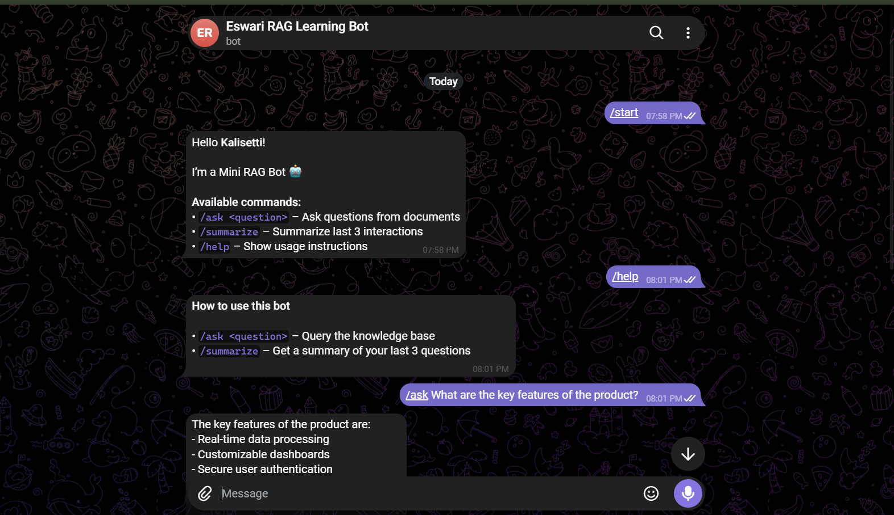
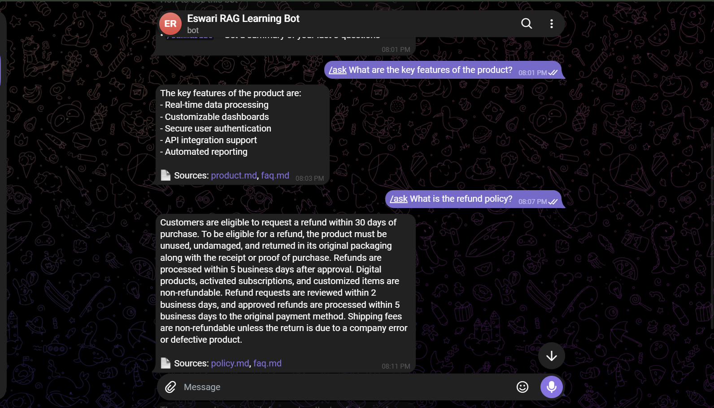
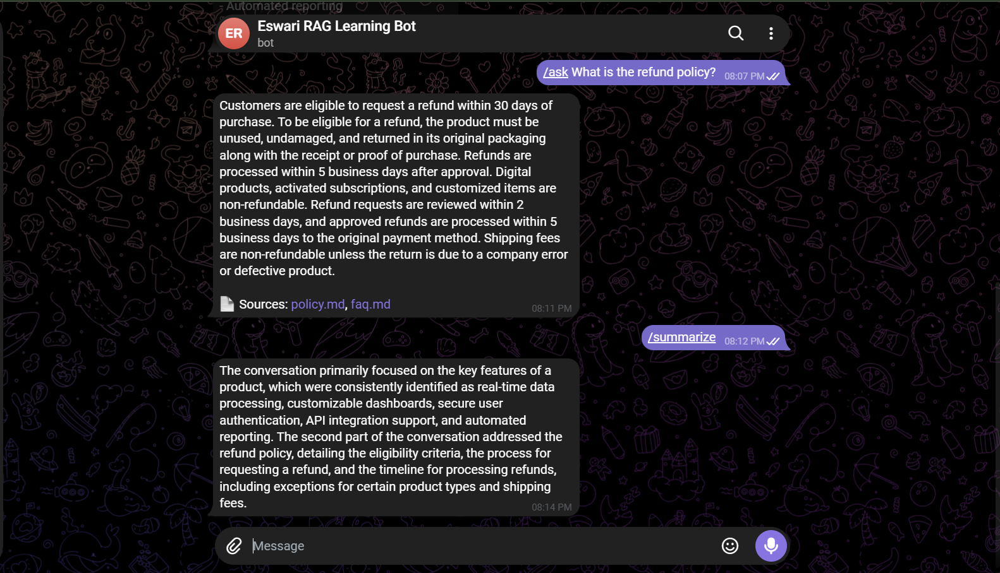

# Mini RAG Telegram Bot

A Telegram chatbot that answers questions from a local document set using Retrieval-Augmented Generation (RAG). Relevant passages are retrieved with vector search and passed to a local Large Language Model, which generates answers grounded in those documents and cites the files they came from.

The entire system runs locally with Docker Compose and uses no external LLM APIs or paid services.

## Project Metadata

- **Original author:** Naveen Kumar
- **Modified by:** Eswari Kalisetti
- **Original project:** [SaraswathiAnalytics/mini-rag-bot](https://github.com/SaraswathiAnalytics/mini-rag-bot)
- **License:** Educational / Learning Use (as stated by the original author)

## Overview

The bot ingests Markdown documents, splits them into chunks, converts each chunk into an embedding and stores everything in a SQLite vector database. When a user asks a question on Telegram, the bot embeds the question, retrieves the most similar chunks, builds a prompt from them and asks a local LLM to answer. The reply includes the names of the source documents used.

## Demo

| Start and help | Ask with sources | Summarize |
|---|---|---|
|  |  |  |

## Features

- Telegram bot interface
- `/ask` command for knowledge-based questions
- **Source citations:** every answer lists the document files it was built from
- Local document ingestion and chunking
- Vector similarity search using SQLite and `sqlite-vec`
- Local embeddings using `sentence-transformers`
- Local LLM inference using **Qwen 2.5 3B Instruct** via Ollama
- `/summarize` command that summarizes the last 3 interactions
- **Re-runnable ingestion:** running ingest again never creates duplicate chunks
- Fully Dockerized with Docker Compose

## Changes in This Version

| Change | Description |
|---|---|
| Qwen 2.5 3B model | Uses `qwen2.5:3b-instruct` so the bot runs on a laptop with 8 GB RAM |
| Source citations | `/ask` answers end with a `Sources:` line, for example `Sources: product.md, faq.md` |
| Source tracking | The `documents` table has a `source` column, filled during ingestion and returned by retrieval |
| Re-runnable ingestion | Tables are rebuilt on every ingest run, so repeated runs do not duplicate chunks |
| `.gitignore` | Keeps `.env`, `.venv/` and `__pycache__/` out of the repository |

Details are documented in [MY_CONTRIBUTIONS.md](MY_CONTRIBUTIONS.md).

## Architecture

```
Documents (data/docs/*.md)
        |
        v
  ingest.py: chunking (400 characters, 50 overlap)
        |
        v
  sentence-transformers (all-MiniLM-L6-v2): 384-dimension embeddings
        |
        v
  SQLite + sqlite-vec (db/rag.db: documents, source, embeddings)

Telegram /ask <question>
        |
        v
  app.py -> retrieve.py: embed the question, fetch the top 4 similar chunks and their sources
        |
        v
  prompts.py: build a prompt from the retrieved chunks and the question
        |
        v
  llm.py: Qwen 2.5 3B (Ollama) generates the answer
        |
        v
  Telegram reply: answer + Sources
```

## Models Used

### Embedding Model

- **Model:** all-MiniLM-L6-v2
- **Reason:** Lightweight, fast and suitable for semantic retrieval on small document collections.

### Language Model

- **Model:** Qwen 2.5 3B Instruct
- **Runtime:** Ollama (local)
- **Reason:** Good instruction following with a small memory footprint, fully offline and able to run on 8 GB RAM.

## Tech Stack

| Area | Tools |
|---|---|
| Language | Python |
| Bot framework | python-telegram-bot (Telegram Bot API) |
| Embeddings | sentence-transformers |
| Vector search | SQLite + sqlite-vec |
| Text splitting | LangChain text splitters |
| LLM runtime | Ollama (Qwen 2.5 3B Instruct) |
| Packaging | Docker, Docker Compose |

## Project Structure

```
mini-rag-bot/
├── data/
│   └── docs/
│       ├── faq.md
│       ├── policy.md
│       └── product.md
├── db/
│   └── rag.db
├── demo/
│   ├── start-help.png
│   ├── ask-sources.png
│   └── summarize.png
├── rag/
│   ├── ingest.py
│   ├── llm.py
│   ├── prompts.py
│   └── retrieve.py
├── app.py
├── docker-compose.yml
├── Dockerfile
├── MY_CONTRIBUTIONS.md
├── README.md
└── requirements.txt
```

## Setup and Run (Docker)

### Prerequisites

- Docker Desktop (Docker and Docker Compose)
- A Telegram account and a bot token from [@BotFather](https://t.me/BotFather)
- About 8 GB RAM

### Step 1: Clone the repository and add documents

```
git clone https://github.com/kalisettieswari321-gif/mini-rag-bot.git
cd mini-rag-bot
```

Place short `.md` or `.txt` files (policies, FAQs, product documentation) inside `data/docs/`.

### Step 2: Configure environment variables

Do not hard-code your Telegram bot token. Create a `.env` file in the project root:

```
BOT_TOKEN=your_telegram_bot_token_here
```

### Step 3: Build and start the containers

```
docker compose up -d --build
```

### Step 4: Download the model

```
docker exec -it ollama ollama pull qwen2.5:3b-instruct
```

### Step 5: Ingest the documents

```
docker compose run --rm rag-bot python rag/ingest.py
```

### Step 6: Restart the bot

```
docker compose up -d --force-recreate rag-bot
```

## Usage

Open Telegram, search for your bot username and start a chat.

### Commands

| Command | Description |
|---|---|
| `/start` | Start the bot |
| `/help` | Show usage instructions |
| `/ask <question>` | Ask a question from the documents |
| `/summarize` | Summarize the last 3 interactions |

### Examples

```
/ask What are the key features of the product?
/ask What topics are covered in the uploaded documents?
```

Example reply:

```
The key features of the product are:
- Real-time data processing
- Customizable dashboards
- Secure user authentication
- API integration support
- Automated reporting

Sources: product.md, faq.md
```

## Security

- The bot token is read from the `BOT_TOKEN` environment variable and stored only in a local `.env` file, which is excluded by `.gitignore`.
- If a token is ever exposed, revoke it with `/revoke` in BotFather and update `.env`.

## Credits and Attribution

This project is based on [mini-rag-bot](https://github.com/SaraswathiAnalytics/mini-rag-bot), created by **Naveen Kumar**. The original architecture and core implementation are his work.

This modified version is published as a separate repository with the permission of the original author. Changes made in this version are listed in [Changes in This Version](#changes-in-this-version) and in [MY_CONTRIBUTIONS.md](MY_CONTRIBUTIONS.md).

## License

The original project is released by its author for educational and learning use. This modified version keeps the original author's credit and follows the same educational and learning purpose.